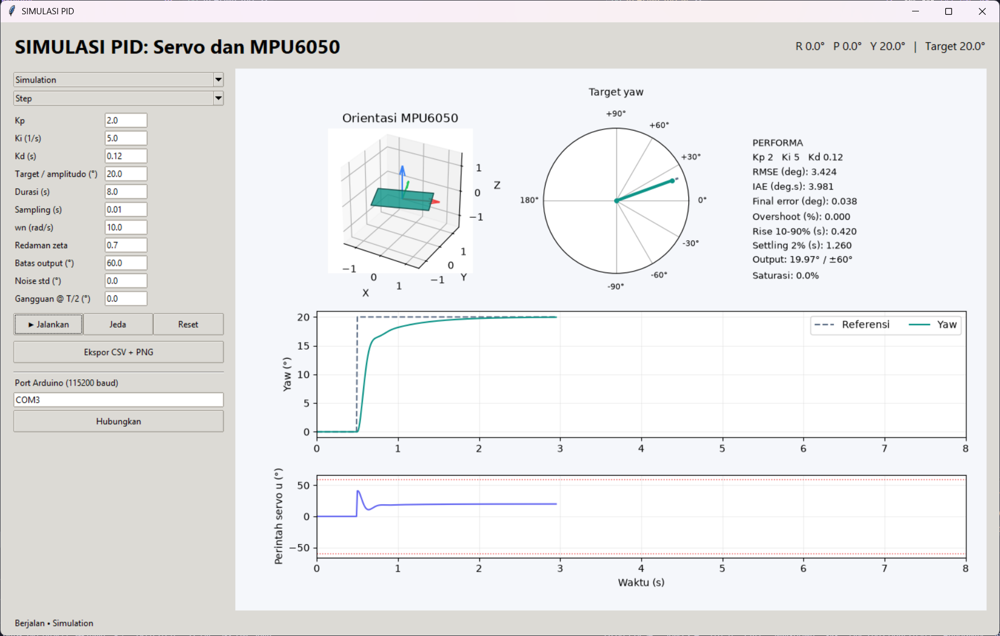
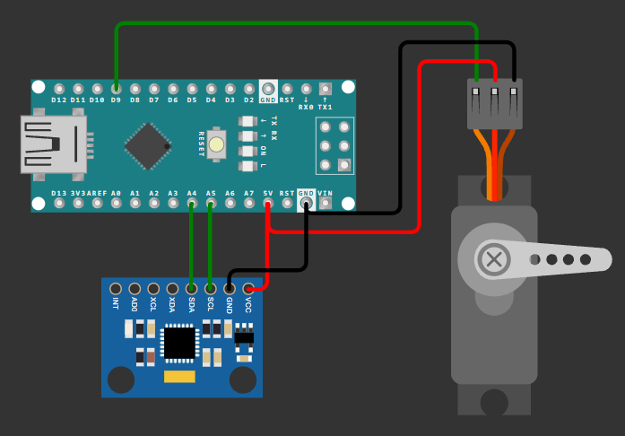
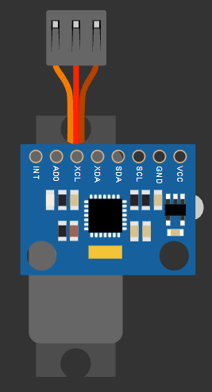

# Simulasi Kendali PID pada Gimbal Single-Axis Berbasis Arduino Nano dan Sensor MPU6050

Repository ini berisi proyek akhir untuk penyelesaian tugas mata kuliah Matematika Sistem Kendali

## Identitas Mahasiswa

- **Nama:** Rafael Andika Radya Hadi Kusuma
- **NIM:** 26/591157/PPA/07434
- **Program Studi:** Magister Elektronika dan Instrumentasi
- **Mata Kuliah:** PMSK - Matematika Sistem Kendali

## Deskripsi Singkat



Program terdiri dari kode hardware Arduino Nano dan aplikasi desktop berbasis Python (Tkinter). Aplikasi desktop dapat digunakan untuk simulasi maupun pengujian langsung pada hardware untuk kendali **yaw satu sumbu** menggunakan servo dan MPU6050. Fungsi hardware yang dijalankan pada board Arduino Nano adalah pembacaan data sensor IMU dan menerima perintah posisi servo dari software. Proses kalkulasi PID dilakukan di software-level dengan Python. Visualisasi pada aplikasi dilengkapi dengan kondisi real-time sensor, grafik, dan posisi servo.

## Struktur main

```text
app.py                          Antarmuka desktop dan integrasi kendali
pid/core.py                     PID, plant simulasi, referensi, dan metrik
pid/hardware.py                 Koneksi serial dan parser telemetry
pid/orientation.py              Transformasi orientasi untuk visualisasi
arduino/servo_mpu_pid/          Firmware MPU6050 dan servo
requirements.txt                Dependensi aplikasi
```

## Instalasi

Aplikasi telah diuji menggunakan Python 3.11 di sistem operasi Windows.

```powershell
git clone https://github.com/therafaeliger/pmsk-pid-project.git
cd pmsk-pid-project
python -m venv .venv
.venv\Scripts\Activate.ps1
python -m pip install -r requirements.txt
python app.py
```

## Cara Menjalankan: Simulasi

1. Pilih **Simulation** dan sinyal **Step**, **Impulse**, **Sine**, atau **Manual** sesuai yang dibutuhkan.
2. Ubah parameter Kp, Ki, Kd, target, dan batas output.
3. Klik **Jalankan**. Jika parameter diubah, klik Jalankan untuk menerapkan konfigurasi dan memulai run baru. **Terapkan & reset** menyiapkan run tanpa langsung menjalankannya.
4. **Jeda** menghentikan sementara; Jalankan melanjutkan jika parameter tetap sama. Sesudah run selesai, Jalankan memulai run baru.
5. Pada mode **Manual**, klik atau seret dial dengan mouse untuk mengubah target yaw.
6. **Simpan sebagai pembanding** mempertahankan kurva run untuk dibandingkan dengan pengaturan lain.
7. **Ekspor CSV + PNG** menyimpan data, grafik, dan konfigurasi JSON ke lokasi yang dipilih. Pada Arduino, ekspor juga menyertakan berkas `_imu.csv` untuk seluruh telemetry.

### Catatan Tambahan
* Step dimulai pada t=0.5 s.
* Impulse adalah pulsa berdurasi 0.1 s mulai dari t=0.5 s.
* Sine memiliki fungsi A sin(2π×0.5×(t−0.5)) dengan frekuensi 0.5 Hz mulai dari t=0.5 s.
* Parameter noise, gangguan, frekuensi natural, dan redaman hanya berlaku pada simulasi.
* Plant simulasi adalah model posisi orde dua dengan parameter nominal wn = 10 rad/s dan zeta = 0.7. Model ini tidak dapat merepresentasikan hardware secara langsung.

## Cara Menjalankan: Hardware dan Firmware Arduino

Siapkan rangkaian Arduino Nano, servo (telah diuji pada seri SG90), modul sensor MPU6050. Buka `arduino/servo_mpu_pid/servo_mpu_pid.ino` di Arduino IDE, pilih board serta port, lalu upload. Firmware menggunakan library `Adafruit_MPU6050` dan `Servo` yang perlu di-install melalui Library Manager.



| Perangkat                 | Koneksi Arduino Nano                                          |
| ------------------------- | ------------------------------------------------------------- |
| Sinyal servo              | D9                                                            |
| V+ servo                  | 5V                                                            |
| GND servo                 | GND                                                           |
| MPU6050 SDA               | A4                                                            |
| MPU6050 SCL               | A5                                                            |
| MPU6050 AD0               | GND                                                           |
| VCC                       | 5V                                                            |

Pasang MPU6050 pada lengan servo (bagian yang ikut diputar servo, sebagai feedback posisi servo berdasarkan pembacaan sensor). Posisi servo 90° menjadi posisi netral, yaw kemudian diukur relatif terhadap posisi awal.



1. Upload firmware, lalu tutup Serial Monitor agar port tersedia untuk aplikasi.
2. Pilih **Arduino**, isi port seperti `COM3`, lalu klik **Hubungkan / putuskan**. Tunggu sekitar 3 detik untuk reset dan kalibrasi.
3. Mode Arduino memakai target berdasarkan pembacaan sensor dan berusaha mengembalikan ke posisi netral.
4. Klik **Jalankan**. Preview roll/pitch/yaw tetap diperbarui sebelum run dan selama jeda; PID hanya mengendalikan yaw.
5. **Jeda** mengirim posisi netral. Menjalankan kembali memulai eksperimen hardware baru. Putuskan koneksi saat selesai.

### Protokol Komunikasi serial

Kecepatan 115200 baud, baris ASCII diakhiri newline:

```text
PC -> Arduino: SET,12.500
Arduino -> PC: IMU,1500,10.000,-5.000,12.300
                     ms,  roll, pitch,   yaw
```

MPU6050 tidak memiliki referensi heading absolut, sehingga yaw relatif dapat drift. Boot ulang pada posisi netral untuk kalibrasi ulang.